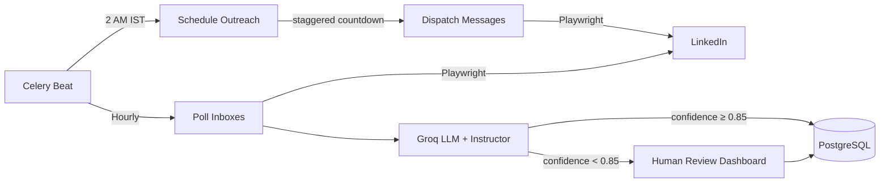

# Project Envoy 🏛️

**Autonomous Alumni Intelligence & Relational Sync Engine**

Project Envoy is a backend system that autonomously reconciles stale alumni database records by dispatching rate-calibrated outreach messages via LinkedIn and parsing unstructured human replies into verified structured data using LLMs, with a human-in-the-loop review dashboard for low-confidence extractions.

## Architecture



### Highlights

- **Rate-Limited Dispatch:** Celery tasks with staggered `countdown` scheduling + Redis atomic rate counters enforce a maximum of 20 outbound messages per account per 24-hour cycle.
- **Deterministic LLM Extraction:** Uses Groq-hosted LLMs with Pydantic + Instructor to convert messy chat replies into strictly typed structured data.
- **Human-in-the-Loop:** Low-confidence extractions (< 85%) are routed to a Streamlit admin dashboard for manual review and correction.
- **Anti-Injection Security:** Inbound messages pass through a regex heuristic engine to block prompt injections before LLM inference.
- **Encrypted Credential Storage:** LinkedIn session cookies are encrypted at rest with Fernet symmetric encryption.
- **Operational Alerting:** Telegram alerts for account cooldowns and system errors.

## Tech Stack

| Layer | Technology |
|-------|-----------|
| API Engine | FastAPI + Uvicorn |
| Task Queue | Celery + Redis (atomic Lua rate limiting) |
| Database | PostgreSQL (psycopg2 connection pool) |
| AI & Parsing | Groq API, Instructor, Pydantic |
| Browser Automation | Playwright (Chromium) |
| Admin Dashboard | Streamlit |
| Infrastructure | Docker Compose |

## Quickstart

1. Copy `.env.example` to `.env` and fill in your credentials:
   ```bash
   cp .env.example .env
   ```

2. Generate a Fernet encryption key:
   ```bash
   python -c "from cryptography.fernet import Fernet; print(Fernet.generate_key().decode())"
   ```

3. Spin up the entire stack:
   ```bash
   docker-compose up --build -d
   ```

4. Add a LinkedIn account to the pool:
   ```bash
   docker exec envoy_worker python -m Scripts.add_account \
     --name college_acc_1 --cookie "YOUR_LI_AT_COOKIE"
   ```

5. Access the services:
   - **API:** http://localhost:8000/health
   - **API Docs (Swagger):** http://localhost:8000/docs
   - **Admin Dashboard:** http://localhost:8501

## API Endpoints

| Method | Endpoint | Auth | Description |
|--------|----------|------|-------------|
| `GET` | `/health` | — | Database connectivity check |
| `GET` | `/stats` | `X-Admin-Password` header | Alumni & account pool statistics |
| `POST` | `/admin/trigger-outreach` | `X-Admin-Password` header | Manually trigger nightly outreach batch |
| `POST` | `/admin/trigger-poll` | `X-Admin-Password` header | Manually trigger inbox polling |

## Project Structure

```
Project-Envoy/
├── app/
│   ├── main.py                # FastAPI control API
│   ├── config.py              # Pydantic settings (env vars)
│   ├── sync_db.py             # Synchronous PostgreSQL connection pool
│   ├── schemas.py             # Pydantic models (LLM output schema)
│   ├── tasks.py               # Celery tasks (outreach, polling, parsing)
│   └── utils/
│       ├── alerts.py          # Telegram alerting
│       ├── crypto.py          # Fernet cookie encryption
│       ├── linkedin_client.py # Playwright LinkedIn automation
│       ├── llm_parser.py      # Groq LLM structured extraction
│       ├── rate_limiter.py    # Redis atomic rate limiting
│       └── security.py        # Prompt injection scanner
├── Scripts/
│   └── add_account.py         # CLI to add encrypted LinkedIn accounts
├── tests/
│   └── evals/
│       └── test_extraction.py # LLM extraction accuracy tests
├── admin_dashboard.py         # Streamlit HITL review UI
├── docker-compose.yml
├── Dockerfile
├── init.sql                   # Database schema + indexes
├── requirements.txt
└── .env.example
```

## License

MIT
